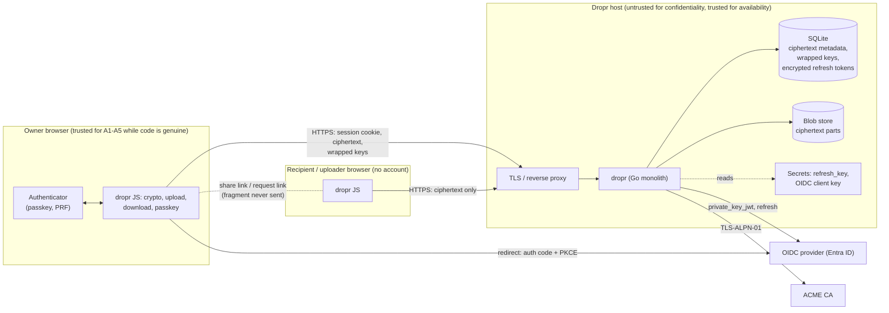

# Dropr threat model

Status: draft for external review (PLAN.md milestone 7). Scope: Dropr as
specified in `PLAN.md`, `docs/ARCHITECTURE.md` and `docs/FORMAT.md`, deployed
as one instance with Microsoft Entra ID (or another OIDC provider) for login.
Where a mitigation is not implemented yet (milestones 3-6 are still landing),
the "Code" column names where it lives or must live. Treat this document as a
checklist to re-verify against the code before a release.

## 1. What Dropr is protecting, and from whom

Dropr lets an authenticated **owner** (a) share a file through a link that
carries the decryption key in the URL fragment, and (b) publish a request link
through which anyone can send files that only that owner can read. The server
stores ciphertext and never sees file content, file names or file keys.

The security claim, stated narrowly:

> A party that gets the database, the blob store, the network traffic, or the
> logs of a Dropr server, but does not run code in the user's browser and does
> not hold the share link or the owner's passkey, learns nothing about file
> contents or names.

The claim does **not** hold against whoever controls the JavaScript the server
delivers (section 6, R1).

## 2. Assets

| # | Asset | Why it matters | Where it lives |
|---|---|---|---|
| A1 | File content | The product | Browser memory (plaintext); server disk (ciphertext, `data_dir/blobs`) |
| A2 | File names and types | Often sensitive | Encrypted metadata in SQLite |
| A3 | File key (FK) | Decrypts one file | Share-link fragment; or HPKE-sealed in `inbox.wrapped_key` |
| A4 | Owner X25519 private key | Decrypts all inbox files | Wrapped per passkey in SQLite; unwrapped only as a non-extractable `CryptoKey` in browser memory |
| A5 | Passkeys (PRF secret) | Unlock A4 | Authenticator hardware; never leaves it. PRF output never leaves the browser |
| A6 | OIDC identity `(iss, sub)` and role | Decides who may be an owner | IdP; sessions table |
| A7 | Session cookie | Acts as the user | Browser (`__Host-`, HttpOnly); SHA-256 hash in SQLite |
| A8 | Refresh tokens | Revalidation, and impersonation toward the IdP | SQLite, AES-256-GCM under `refresh_key` |
| A9 | `refresh_key` | Decrypts A8 | File on host / Docker secret |
| A10 | OIDC client key (private_key_jwt) | Authenticates Dropr to the IdP | File on host / Docker secret |
| A11 | Served JavaScript (the `/assets` bundle) | Anything it does, it does with A1-A5 | Embedded in the binary; verified by published hashes |
| A12 | Availability and disk space | A 100 GB upload feature is a DoS surface | Host |
| A13 | Metadata: sizes, timestamps, link graph, IP hash | Privacy | SQLite, logs |

## 3. Trust boundaries and data flow

Trust boundaries, in order of importance:

1. **Browser vs server.** The server is untrusted with plaintext and keys; the
   browser is where encryption happens. The URL fragment is the only channel
   for FK that never touches the server.
2. **Server code delivery.** The browser trusts the server to deliver genuine
   JavaScript. This boundary cannot be enforced by Dropr alone (R1).
3. **Dropr vs IdP.** Identity and the role come from the IdP; Dropr verifies
   signatures, issuer, audience, nonce and role on every login and refresh.
4. **Anonymous internet vs request links.** Anyone with a request link can
   create inbox entries for that owner. Bounded by caps and rate limits.
5. **Host operator vs data.** The operator (shell access) holds the database,
   blobs and secrets, and runs the admin CLI. They cannot decrypt files, but
   they can serve malicious JS, delete data and read metadata.

## 4. Attackers and outcomes

| Attacker | Capability | Outcome | Main mitigations |
|---|---|---|---|
| Passive network | Observes traffic | Sees host, sizes, timing. No content, names or keys | TLS 1.2+ (AEAD only), HSTS preload, fragment not sent, `Referrer-Policy: no-referrer` |
| Active network / MITM | Intercepts, modifies | Cannot serve JS without a valid certificate | TLS, HSTS with `includeSubDomains; preload`, CAA record, ACME TLS-ALPN-01 |
| Database or disk thief | Reads SQLite and blobs, no secrets | Ciphertext, sizes, timestamps, wrapped keys, encrypted refresh tokens, hashes. No plaintext, no names | E2E encryption; refresh tokens under `refresh_key`; session IDs and tokens stored as hashes |
| Database + `refresh_key` thief | Above plus secrets | Can use refresh tokens against the IdP while they are valid (impersonation toward IdP, up to the token lifetime). Still cannot read files | Store `refresh_key` separately (systemd credentials / Docker secret); revoke sessions at the IdP; rotate (operations.md) |
| Stolen IdP credentials | Logs in as the owner | Can create shares, see link metadata, delete files. **Cannot read the inbox** without the passkey | MFA / phishing-resistant Conditional Access at the IdP; passkey unlock required for inbox and request links; session ID rotated at unlock |
| Stolen session cookie | Acts as the owner until expiry | Same as stolen IdP credentials. Inbox only if the session is already unlocked. **Cannot add or delete passkeys** without a fresh assertion by one of the owner's passkeys (security audit M-1) | `__Host-`, HttpOnly, Secure, SameSite=Strict; 30 min idle, 8 h absolute, 15 min revalidation; `dropr user revoke` |
| Malicious IdP admin / compromised IdP | Mints tokens for any user | Can log in as any owner. Cannot read inboxes without passkeys, nor add or remove passkeys. Can mint tokens for new `sub`s, and can claim an account that has no passkey yet (new account, or after `reset-keys`: see R13) | Issuer pinning, `required_claims`, role check, passkey step-up bound to each sensitive action; monitor `user list` |
| Departed user | Valid account until disabled | Session dies at next revalidation (at most 15 min); their request links stop accepting uploads once a revalidation or login found the role missing, or after `dropr user revoke` | Role removal / disable at IdP; `dropr user revoke` for immediate effect |
| Holder of a share link | Anyone the link reached | Reads the file until expiry, revocation or download limit | Mandatory expiry (1 h to 30 d), `max_downloads` (each counted token serves at most 2 × size + min(size, 1 MiB) bytes), revocation deletes blobs. Operators should educate users: the link is the secret |
| Holder of a request link | Anyone | Uploads to that owner's inbox up to caps; learns the owner's display name and public key | `max_files`, `max_bytes`, `single_use`, expiry, per-IP rate limit, owner quota, disk-space check |
| Malicious uploader | Crafts files and metadata | Cannot affect other owners. Content is never rendered. Can try to exhaust quota or inject hostile file names | Files are saved as downloads, never displayed; metadata sanitized and size-capped (FORMAT §5); caps |
| Malicious owner (insider with role) | Authenticated | Can fill disk up to own quota; can share illegal content (the server cannot see it) | Per-user quota, `max_file_size`, disk-space check. Content policy is an operator/legal matter (section 7) |
| Compromised Dropr server / malicious operator | Controls code and data | **Can deliver malicious JS that steals keys and plaintext (R1).** Can read all metadata, delete data, inject inbox entries | Minimal JS, no third-party code, CSP, reproducible build, published hashes (SECURITY.md); external users verify the bundle |
| Supply-chain attacker | Poisons a dependency | Same as a compromised server, at build time | Zero runtime JS dependencies; pinned, locked dev dependencies (`package-lock.json`, `go.sum`); Nix build with fixed-output hashes; `govulncheck`, `npm audit`; SBOM; signed releases |
| Cross-site attacker | Web page in the victim's browser | Cannot make state-changing requests as the user | `SameSite=Strict`, `Sec-Fetch-Site`/`Origin` checks on all non-GET requests, CSP `form-action`, `frame-ancestors 'none'` |
| XSS attacker | Injects script into a Dropr page | Would equal R1 | `html/template` auto-escaping, no inline scripts or styles, strict CSP (`script-src 'self'`, Trusted Types required), uploaded content never rendered |
| Brute-force / enumeration | Guesses IDs | Infeasible | 128-bit random IDs; rate limits; uniform 404 for unknown and expired links |
| Resource-exhaustion attacker | Slowloris, trickling transfers, huge bodies, many uploads | Service degradation | Server timeouts, minimum transfer rate (4 KiB/s over 60 s), concurrent transfer caps (512 total, 32 per address), per-route body limits, rate limits, quotas, disk reservation for uploads in progress, 24 h GC of incomplete uploads, systemd/container limits |

## 5. STRIDE by component

S = spoofing, T = tampering, R = repudiation, I = information disclosure,
D = denial of service, E = elevation of privilege.

### 5.1 Browser modules (`web/src`)

| | Threat | Mitigation | Code |
|---|---|---|---|
| T | Ciphertext truncated, reordered or spliced | STREAM construction: counter and last-segment flag in the nonce; output is provisional until the stream ends cleanly; partial files aborted | `web/src/crypto/stream.ts`, `web/src/lib/downloader.ts` |
| T | Server swaps the owner's public key in a request link | Public key derived from the *unwrapped, authenticated* private key, never from the server | `web/src/crypto/keywrap.ts`, `web/src/crypto/hpke.ts`, FORMAT §8.8 |
| T | Server moves an inbox file to another request | `requestId` bound in HPKE `info` | `web/src/crypto/hpke.ts` |
| I | Private key exfiltrated by page script | Re-imported non-extractable after unwrap; only extractable transiently to register another passkey | `web/src/crypto/keywrap.ts`, FORMAT §8.9 |
| I | Fragment leaks through Referer or requests | `Referrer-Policy: no-referrer`; the fragment is never put in a request URL, API call or log | `internal/httpx/headers.go`, `web/src/lib/linkview.ts` |
| I | Hostile file names attack the UI or filesystem, or spoof an extension | Names decrypted client-side, treated as text, sanitized: controls, bidi and all default-ignorable characters (Hangul fillers, Braille blank, soft hyphen…) removed, runs of spaces of any width collapsed to one, path and Windows-reserved characters replaced, length capped | `web/src/lib/decrypt-names.ts`, FORMAT §5 |
| D | Memory exhaustion on 100 GB files | Streaming, bounded parallelism, 32 MiB parts, no whole-file buffering | `web/src/lib/uploader.ts`, `downloader.ts` |
| E | Malicious or tampered JS | See R1. CSP, no third-party code, reproducible build, published hashes | `web/scripts/build.ts`, `flake.nix`, SECURITY.md |

### 5.2 Authentication (OIDC, `internal/auth/oidc`)

| | Threat | Mitigation | Code |
|---|---|---|---|
| S | Forged or replayed ID token | Signature against discovered JWKS (asymmetric only; never `none` or HS*), `iss`, `aud`, `azp`, `exp`/`nbf`/`iat`, `nonce`, `required_claims` | `internal/auth/oidc` |
| S | Authorization-code injection, login CSRF | PKCE S256, `state` and `nonce` in a sealed `__Host-` cookie, deleted at callback | `internal/auth/oidc/handlers.go`, `internal/seal` |
| S | Tokens from another tenant or issuer | Single pinned issuer; multi-tenant and templated issuers refused; `tid` check for Entra | `internal/config/config.go` |
| S | Client impersonation toward the IdP | `private_key_jwt`; client secret only in dev mode | `internal/auth/oidc/assertion.go`, `internal/config` |
| S | Identity confusion via email or name | Identity is `(iss, sub)`; other claims display-only (control characters stripped in CLI) | `internal/store/users.go`, `cmd/dropr/main.go` |
| E | User without the role | Role claim checked at login and every revalidation; no account is created on denial | `internal/auth/oidc` |
| E | Session outlives revoked access | Refresh every `revalidate_every` (max 1 h, default 15 min); refresh failure, `sub` change or lost role kills the session; front-channel logout; `dropr user revoke` | `internal/auth/session`, `internal/auth/oidc` |
| R | No record of who did what | Structured request logs with route, status, request ID and a keyed IP hash; admin actions are CLI-only and visible in the host's shell audit | `internal/httpx/middleware.go` |

### 5.3 Sessions and passkeys (`internal/auth/session`, `internal/auth/passkey`)

| | Threat | Mitigation |
|---|---|---|
| S | Session fixation or theft from the database | 256-bit random ID; only its SHA-256 stored; ID rotated at login and at passkey unlock |
| S | Passkey assertion replay or relay | Server-side challenge bound to the OIDC session; `userVerification: required`; sign counter stored |
| I | Wrapped private key stolen with the database | Wrapped under a per-passkey KEK derived from the PRF output, which exists only in the authenticator and the browser |
| T | Server returns a different wrapped key | AES-GCM authenticates it under the KEK with a labeled AAD; wrong key fails |
| D | All passkeys lost | **By design the inbox is unreadable** (PLAN §2); UI requires 2 passkeys; `dropr user reset-keys` wipes and restarts |
| E | Passkey removal or substitution to lock the owner out (stolen unlocked session) | Adding or deleting a passkey needs a fresh, user-verified assertion by an existing passkey, made in the same session for that exact action (and passkey), ≤ 5 min old, single-use; the 8 h unlock flag never suffices. Deleting is refused if fewer than 2 would remain. Additions and deletions are logged at WARN |
| S | Claiming the initial setup | The first registration (0 passkeys) needs no grant, but belongs to the session that began it (others get 409 while it is pending) and its registration ceremony requires user verification over a server challenge (an optional confirmation assertion by the new credential is verified if sent); the second passkey needs a grant from the first. Residual: R13 |
| T | Session rotation racing revalidation loses a rotated refresh token | Rotation takes the same per-session lock as revalidation and copies the refresh token from the row as stored inside its transaction |

### 5.4 HTTP layer (`internal/httpx`, `internal/server`)

| | Threat | Mitigation | Code |
|---|---|---|---|
| T | CSRF | SameSite=Strict cookie; reject non-GET unless `Sec-Fetch-Site` is same-origin/none, else `Origin` equals the public origin | `internal/httpx/csrf.go` |
| T | Clickjacking | `frame-ancestors 'none'`, `X-Frame-Options: DENY` | `internal/httpx/headers.go` |
| I | Cached sensitive responses | `Cache-Control: no-store` on pages with links and on the API | `internal/httpx/headers.go` |
| I | Spoofed client IP via forwarded headers | `X-Forwarded-*` trusted only from `trusted_proxies` (or a `unix:` socket peer with `trust_unix_socket_proxy`); IPs only logged as keyed hashes | `internal/httpx/clientip.go` |
| D | Every client behind a misconfigured proxy shares one rate-limit bucket (one client locks out sign-in for all) | Production refuses proxy mode without `trusted_proxies` (TCP) or `trusted_proxies`/`trust_unix_socket_proxy` (unix socket); dev warns; runtime warnings for undeterminable addresses and untrusted X-Forwarded-For | `internal/config/config.go` |
| D | Slowloris, trickling transfers, oversized bodies, floods | `ReadHeaderTimeout`, idle timeout, header limits, per-route body limits, in-memory rate limiting, minimum transfer rate, concurrent transfer caps | `internal/httpx/ratelimit.go`, `internal/httpx/streams.go`, `internal/blob/serve.go`, `internal/server/server.go` |
| I | Responses without security headers | Every handler response, including ServeMux redirects and 404/405, passes the header middleware. Only answers `net/http` writes before routing (400 on a malformed request line, 431 for oversized headers, plain-HTTP-to-HTTPS) lack them: they are fixed `text/plain` with nothing reflected (accepted) | `internal/httpx/headers.go` |
| E | Reaching unlisted functionality | `ServeMux` patterns; anything not listed returns 404 | `internal/server/server.go` |

### 5.5 Storage and jobs (`internal/db`, `internal/store`, `internal/blob`, `internal/jobs`)

| | Threat | Mitigation |
|---|---|---|
| T | Blob tampered on disk | Detected on decryption (per-segment GCM tags, STREAM final flag); nothing is released before authentication |
| I | Disk theft | Ciphertext only; protect the host with full-disk encryption anyway (DB holds wrapped keys and encrypted refresh tokens) |
| I | Backups leak | `dropr backup` output has the same properties as the live database: protect it; blobs are already ciphertext |
| D | Disk filled by uploads | Free-space check before accepting that also reserves what the uploads in progress still have to write, per-owner quota, instance and per-link caps, GC of incomplete uploads after 24 h, expiry cleanup every 5 min |
| T | A part replacing data after finalize (uploader changes a file the owner already saw) | Part rename and finalize serialized by a per-blob lock with a state re-check; parts arriving after finalize are discarded (409) |
| I | Secret files readable by other local users | Warning if group/world-readable; production refuses world-readable (except `/run/credentials`, `/run/secrets`) |
| E | Path traversal via IDs | IDs are fixed-length base64url from a strict parser; sharded directory layout derived from the ID only |
| D | Orphaned blobs consume disk after purge | `dropr gc` reclaims them |

### 5.6 Operator tooling and deployment

| | Threat | Mitigation |
|---|---|---|
| E | Compromised process escapes | Static non-root binary, read-only root filesystem, no capabilities, `no-new-privileges`, no shell in the image; NixOS module adds `DynamicUser`, `ProtectSystem=strict`, syscall filter, `MemoryDenyWriteExecute` |
| I | Secrets in environment or database | Secrets are loaded from files only (Docker secrets / systemd credentials) |
| T | Tampered release | Reproducible Nix build, signed tags, cosign-signed image, SBOM, published asset hashes (SECURITY.md) |
| E | Admin CLI abuse | Admin access is shell access; no admin web UI exists to attack |

## 6. Residual risks (accepted, with advice)

**R1. Malicious JavaScript from a compromised or malicious server.** Browser
end-to-end encryption inherits the trust in whoever serves the code. An
attacker who controls the server (or its TLS certificate, DNS, or the build
pipeline) can deliver a bundle that exfiltrates share-link fragments, the
unlocked private key operations, or plaintext. Dropr cannot fully prevent this.
It reduces and exposes the risk: no third-party scripts, a few small modules,
strict CSP with Trusted Types, reproducible builds, hash-pinned release assets,
and a documented procedure for users to verify `/assets` against a release
(SECURITY.md). A Subresource-Integrity-style check helps only if verification
happens outside the served page. For high-value use, the owner should verify
the bundle hashes (or use a verified browser extension in a future version).
The service worker is part of the trusted code base and is served from a fixed
`/sw.js`; a compromised one persists until updated, so the response carries
`Service-Worker-Allowed: /_dl/` (its only scope, so even injected script cannot
register it over the whole origin) and the browser re-fetches it on
navigation.

**R2. Metadata leakage to the server.** The server learns exact plaintext sizes
(no padding), upload and download times, part counts, link expiry, download
counts, who owns which link, which request link a file arrived through, the
owner's display name and public key, the number of received files (shown to
the owner only once the session is unlocked), and IP addresses (only as keyed hashes in
logs, but visible to the network and any fronting proxy in transit). File names
and types are encrypted. Sizes and timing can fingerprint well-known files.

**R3. AES-GCM is not key-committing.** A sender can craft a ciphertext that
decrypts under two keys. Dropr never tries several keys on one blob and no
feature depends on a blob having a unique plaintext (FORMAT §8.4). If a feature
such as abuse reporting is added, add a key commitment first.

**R4. Share-link leakage through the browser.** The key is in the fragment, so
it ends up in browser history, bookmarks and synced history (Chrome Sync, Firefox
Sync, iCloud Tabs), in the clipboard, in chat apps that unfurl or log links
(a link-preview bot would fetch the URL but does not receive the fragment; a
client that logs the full URL does), in screenshots, and in browser extensions
that read tab URLs. Anyone who obtains the full link can read the file until
expiry. Mitigations: short expiry, `max_downloads`, revocation, advising
recipients to use private windows for sensitive files. Browsers may in future
send fragments to extensions or "safe browsing" services; Dropr cannot control
that.

**R5. Link holder is the authority.** There is no recipient authentication for
share links or uploader authentication for request links. Possession equals
access.

**R6. Plaintext on the recipient's device.** After download the file is
ordinary plaintext on disk (and possibly in synced folders, previews, antivirus).
Out of Dropr's control.

**R7. Passkey loss and platform sync.** Losing all passkeys loses the inbox by
design. Synced passkeys (iCloud Keychain, Google Password Manager) extend the
trust base to those vendors' accounts.

**R8. Uploaded content is untrusted.** Inbox files may be malware. Dropr never
renders them, but the owner opens them on their device. The inbox UI warns.

**R9. Availability depends on one host.** No replication, no high availability.
Back up (docs/operations.md).

**R10. Time of check at the IdP.** Access removal propagates at the next
revalidation: up to `revalidate_every` (default 15 min) plus idle behavior.
`dropr user revoke` is immediate.

**R11. The operator is powerful.** Shell access gives deletion, metadata,
secrets and the ability to serve modified code (R1). Dropr protects users from
a *curious* operator's data access, not from a *malicious* operator's code
delivery.

**R12. Request-link spam.** Anyone with a request link can submit unwanted
files within caps. Revoke the link; it deletes everything it received.

**R13. The first passkey goes to whoever signs in first.** An account without
passkeys (new, or after `dropr user reset-keys`) is set up by the first
session that completes a passkey registration. Request links are then minted
to that key pair. The setup window is bound to the session that starts it,
the first passkey must prove a user-verified assertion, and the second needs
a grant from the first, so a later intruder cannot add passkeys; but an
attacker holding the user's IdP credentials *before* the user's first
sign-in (or right after a `reset-keys`) can claim the account key. Advice:
require phishing-resistant MFA at the IdP; after `reset-keys`, have the user
sign in and complete setup promptly; check `dropr user list` (passkey count)
and the WARN log lines "passkey added". A one-time enrollment code printed by
the CLI is a possible future hardening.

**R14. A download token can be handed on.** A share download token (and the
link key) can be passed to third parties, who can use what remains of its
byte budget (at most 2 × size + min(size, 1 MiB)). `max_downloads` therefore
bounds the bytes served, roughly two copies per counted download, not the
number of people.

## 7. Out of scope

* Compromise of the user's device, browser or OS (keyloggers, malicious
  extensions, malware with memory access).
* Malicious or compromised authenticators; side channels in WebCrypto or the
  browser's implementation of the PRF extension.
* Traffic analysis beyond sizes and timing (padding, cover traffic, anonymity;
  Dropr is not Tor-grade).
* Content moderation, malware scanning and legal obligations for hosted
  content (the server cannot see it).
* Multi-instance, federation and peer-to-peer designs (non-goals).
* Denial of service at the network layer (volumetric attacks); use a provider
  or upstream filtering.
* Post-quantum adversaries: X25519/HPKE and AES-256-GCM. Harvest-now-decrypt-later
  applies to captured request-link uploads (the HPKE-sealed FK) if a CRQC ever
  exists. The format is versioned (`dropr/v1`) to allow a hybrid KEM later.
* Compromise of the IdP's own security (it is trusted for authentication, not
  for confidentiality).
* Physical access to a running host with secrets in memory.

## 8. Verification pointers

* Crypto: `web/test/` runs published test vectors and property tests
  (round-trip, truncation, reordering, tampering).
* Go: negative OIDC tests (alg none, HS256, wrong issuer/audience/nonce, expired,
  missing role) in `internal/auth/oidc`; native fuzz targets for every parser of
  untrusted input; `govulncheck` in CI.
* End-to-end: Playwright suites against Keycloak (milestone 6).
* Before real use: external review (PLAN §11, milestone 7).
